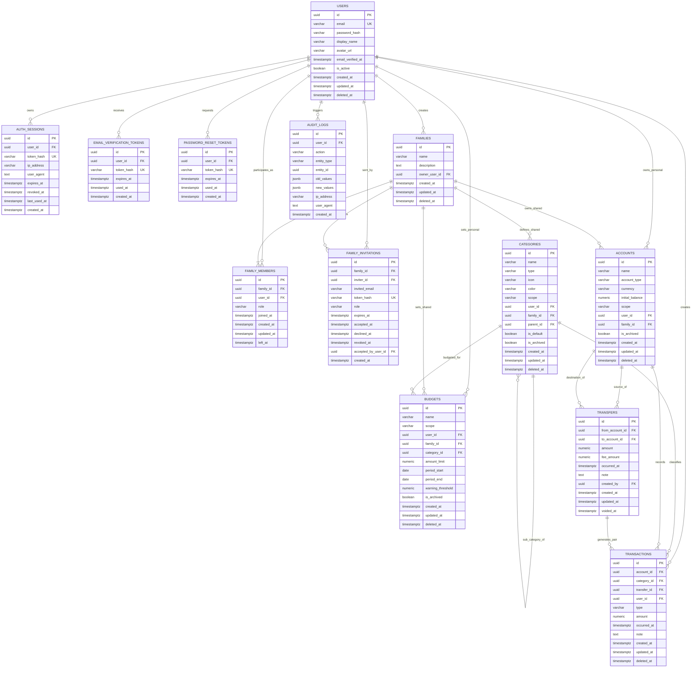

# Thiết Kế Sơ Đồ Thực Thể - Quan Hệ (ERD) Chi Tiết
## Hệ Thống Quản Lý Chi Tiêu Cá Nhân & Gia Đình (Expense Tracker)

Tài liệu này định nghĩa cấu trúc cơ sở dữ liệu chi tiết, các ràng buộc dữ liệu, quy tắc toàn vẹn nghiệp vụ và sơ đồ ERD phục vụ triển khai backend FastAPI, SQLAlchemy 2.x, Alembic migrations trên nền tảng **PostgreSQL 18**.

---

## 1. Mục Đích và Phạm Vi Hệ Thống

Hệ thống được thiết kế nhằm giải quyết bài toán quản lý tài chính cá nhân và tài chính hộ gia đình trên cùng một nền tảng hợp nhất:
1. **Phạm vi Cá nhân (Personal Scope)**: Mỗi người dùng có các ví cá nhân (tiền mặt, tài khoản ngân hàng, ví điện tử...), theo dõi thu chi độc lập, bảo mật và riêng tư tuyệt đối.
2. **Phạm vi Gia đình (Family Scope)**: Người dùng có thể tạo nhóm gia đình hoặc tham gia nhóm thông qua lời mời. Trong nhóm gia đình, các ví chung, danh mục và ngân sách chung được chia sẻ với phân quyền rõ ràng (`owner`, `editor`, `viewer`).
3. **Toàn vẹn và Minh bạch Tài chính**:
   - Mọi khoản tiền đều sử dụng định dạng số học chính xác cao (`NUMERIC(15, 2)`).
   - Hoạt động chuyển tiền liên ví (Transfer) được quản lý nguyên tử (Atomic paired transactions) và loại trừ khỏi báo cáo thu/chi thuần nhằm tránh thổi phồng dòng tiền.
   - Dữ liệu tài chính không bị xóa cứng (hard delete) vô tình, mọi thao tác quan trọng đều được ghi nhận qua bảng `audit_logs`.

---

## 2. Sơ Đồ ERD Tổng Thể (Mermaid Diagram)



---

## 3. Chi Tiết Các Thực Thể & Thuộc Tính

### 3.1. Phân Hệ Xác Thực & Người Dùng (Users & Auth)

#### Bảng `users` (Tài khoản và thông tin hồ sơ)
Lưu trữ thông tin định danh của người dùng trong hệ thống.
* **Quy chuẩn mật khẩu**: Mật khẩu được băm bằng thuật toán an toàn (Argon2id hoặc bcrypt) trước khi lưu vào `password_hash`, không bao giờ lưu văn bản thuần.

| Tên Cột | Kiểu Dữ Liệu | Ràng Buộc | Mô Tả |
|---|---|---|---|
| `id` | `UUID` | `PRIMARY KEY DEFAULT gen_random_uuid()` | Định danh người dùng |
| `email` | `VARCHAR(255)` | `NOT NULL UNIQUE` | Địa chỉ email đăng nhập chuẩn hóa (lowercase) |
| `password_hash` | `VARCHAR(255)` | `NOT NULL` | Chuỗi băm mật khẩu bảo mật |
| `display_name` | `VARCHAR(150)` | `NOT NULL` | Tên hiển thị người dùng |
| `avatar_url` | `VARCHAR(500)` | `NULL` | Đường dẫn ảnh đại diện |
| `email_verified_at` | `TIMESTAMPTZ` | `NULL` | Thời điểm xác minh email (xác thực thành công khi khác NULL) |
| `is_active` | `BOOLEAN` | `NOT NULL DEFAULT TRUE` | Trạng thái tài khoản (khóa/mở) |
| `created_at` | `TIMESTAMPTZ` | `NOT NULL DEFAULT clock_timestamp()` | Thời điểm tạo |
| `updated_at` | `TIMESTAMPTZ` | `NOT NULL DEFAULT clock_timestamp()` | Thời điểm cập nhật cuối |
| `deleted_at` | `TIMESTAMPTZ` | `NULL` | Đánh dấu xóa mềm (Soft Delete) |

* **Indexes**:
  * `idx_users_email` (UNIQUE trên `lower(email)`).
  * `idx_users_deleted_at` (hỗ trợ lọc tài khoản đang hoạt động).

---

#### Bảng `auth_sessions` (Phiên đăng nhập & Opaque Session Token)
Quản lý các phiên đăng nhập thông qua opaque session token và theo dõi thiết bị người dùng.

| Tên Cột | Kiểu Dữ Liệu | Ràng Buộc | Mô Tả |
|---|---|---|---|
| `id` | `UUID` | `PRIMARY KEY DEFAULT gen_random_uuid()` | ID phiên đăng nhập |
| `user_id` | `UUID` | `NOT NULL REFERENCES users(id) ON DELETE CASCADE` | Khóa ngoại người dùng |
| `token_hash`| `VARCHAR(255)` | `NOT NULL UNIQUE` | Băm SHA-256 của opaque session token |
| `ip_address` | `VARCHAR(45)` | `NULL` | Địa chỉ IP (IPv4 hoặc IPv6) |
| `user_agent` | `TEXT` | `NULL` | Thông tin trình duyệt/thiết bị |
| `expires_at` | `TIMESTAMPTZ` | `NOT NULL` | Thời điểm phiên hết hạn |
| `revoked_at` | `TIMESTAMPTZ` | `NULL` | Thời điểm phiên bị thu hồi |
| `last_used_at`| `TIMESTAMPTZ`| `NOT NULL DEFAULT clock_timestamp()` | Thời điểm phiên được dùng gần nhất |
| `created_at` | `TIMESTAMPTZ` | `NOT NULL DEFAULT clock_timestamp()` | Thời điểm tạo phiên |

* **Indexes**:
  * `idx_auth_sessions_user_id` (truy vấn danh sách thiết bị của user).
  * `idx_auth_sessions_token_hash` (xác thực token nhanh).
  * `idx_auth_sessions_expires_at` (hỗ trợ dọn dẹp phiên hết hạn).

---

#### Bảng `email_verification_tokens` (Token xác thực email)
Lưu token một lần gửi qua email khi đăng ký tài khoản.

| Tên Cột | Kiểu Dữ Liệu | Ràng Buộc | Mô Tả |
|---|---|---|---|
| `id` | `UUID` | `PRIMARY KEY DEFAULT gen_random_uuid()` | ID bản ghi |
| `user_id` | `UUID` | `NOT NULL REFERENCES users(id) ON DELETE CASCADE` | Khóa ngoại người dùng |
| `token_hash` | `VARCHAR(255)` | `NOT NULL UNIQUE` | Băm SHA-256 của token gửi qua email |
| `expires_at` | `TIMESTAMPTZ` | `NOT NULL` | Thời hạn hiệu lực (thường 24h) |
| `used_at` | `TIMESTAMPTZ` | `NULL` | Thời điểm token được kích hoạt thành công |
| `created_at` | `TIMESTAMPTZ` | `NOT NULL DEFAULT clock_timestamp()` | Thời điểm tạo token |

---

#### Bảng `password_reset_tokens` (Token khôi phục mật khẩu)
Quản lý token đặt lại mật khẩu với thời hạn ngắn (15 - 30 phút).

| Tên Cột | Kiểu Dữ Liệu | Ràng Buộc | Mô Tả |
|---|---|---|---|
| `id` | `UUID` | `PRIMARY KEY DEFAULT gen_random_uuid()` | ID bản ghi |
| `user_id` | `UUID` | `NOT NULL REFERENCES users(id) ON DELETE CASCADE` | Khóa ngoại người dùng |
| `token_hash` | `VARCHAR(255)` | `NOT NULL UNIQUE` | Băm SHA-256 của reset token |
| `expires_at` | `TIMESTAMPTZ` | `NOT NULL` | Thời hạn hiệu lực |
| `used_at` | `TIMESTAMPTZ` | `NULL` | Thời điểm token đã được sử dụng |
| `created_at` | `TIMESTAMPTZ` | `NOT NULL DEFAULT clock_timestamp()` | Thời điểm tạo token |

---

### 3.2. Phân Hệ Gia Đình (Family & Membership)

#### Bảng `families` (Nhóm gia đình)
Nhóm không gian chia sẻ tài chính gia đình.

| Tên Cột | Kiểu Dữ Liệu | Ràng Buộc | Mô Tả |
|---|---|---|---|
| `id` | `UUID` | `PRIMARY KEY DEFAULT gen_random_uuid()` | ID gia đình |
| `name` | `VARCHAR(100)` | `NOT NULL` | Tên nhóm gia đình (ví dụ: "Gia đình Tuấn & Lan") |
| `owner_user_id`| `UUID` | `NOT NULL REFERENCES users(id) ON DELETE RESTRICT`| Chủ nhóm / Người sáng lập gia đình |
| `created_at` | `TIMESTAMPTZ` | `NOT NULL DEFAULT clock_timestamp()` | Thời điểm tạo |
| `updated_at` | `TIMESTAMPTZ` | `NOT NULL DEFAULT clock_timestamp()` | Thời điểm sửa |
| `deleted_at` | `TIMESTAMPTZ` | `NULL` | Đánh dấu giải tán nhóm (Soft Delete) |

---

#### Bảng `family_members` (Thành viên và vai trò)
Xác định quyền truy cập trong gia đình.
* **Vai trò (`role`)**:
  * `owner`: Chủ nhóm, toàn quyền quản trị, thêm/bớt thành viên, sửa/xóa ví gia đình.
  * `editor`: Thành viên có quyền tạo, sửa giao dịch, ngân sách trong nhóm.
  * `viewer`: Thành viên chỉ có quyền xem số dư, giao dịch và báo cáo.

| Tên Cột | Kiểu Dữ Liệu | Ràng Buộc | Mô Tả |
|---|---|---|---|
| `id` | `UUID` | `PRIMARY KEY DEFAULT gen_random_uuid()` | ID bản ghi thành viên |
| `family_id` | `UUID` | `NOT NULL REFERENCES families(id) ON DELETE RESTRICT` | Khóa ngoại gia đình (ngăn xóa vật lý khi còn lịch sử thành viên) |
| `user_id` | `UUID` | `NOT NULL REFERENCES users(id) ON DELETE RESTRICT` | Khóa ngoại người dùng |
| `role` | `VARCHAR(20)` | `NOT NULL CHECK (role IN ('owner', 'editor', 'viewer'))` | Vai trò trong nhóm |
| `joined_at` | `TIMESTAMPTZ` | `NOT NULL DEFAULT clock_timestamp()` | Thời điểm tham gia |
| `created_at` | `TIMESTAMPTZ` | `NOT NULL DEFAULT clock_timestamp()` | Thời điểm tạo bản ghi |
| `updated_at` | `TIMESTAMPTZ` | `NOT NULL DEFAULT clock_timestamp()` | Thời điểm cập nhật vai trò |
| `left_at` | `TIMESTAMPTZ` | `NULL` | Thời điểm rời nhóm (NULL: đang hoạt động) |

* **Constraints & Indexes**:
  * `UNIQUE (family_id, user_id)`: Một người chỉ có một tư cách thành viên trong một gia đình.
  * `idx_family_members_user_id`: Truy vấn nhanh danh sách các gia đình mà user tham gia.
  * `idx_family_members_left_at`: Lọc nhanh các thành viên đang hoạt động trong nhóm.

---

#### Bảng `family_invitations` (Lời mời gia nhập gia đình)
Quản lý quy trình gửi lời mời và tham gia nhóm gia đình qua email an toàn.
* **Nguyên tắc an toàn**: Không lưu token thô trong database; chỉ lưu băm bảo mật SHA-256 (`token_hash`).
* **Trạng thái lời mời**: Được xác định động qua các mốc thời gian:
  * `accepted`: Đã chấp nhận (`accepted_at IS NOT NULL` và `accepted_by_user_id IS NOT NULL`).
  * `declined`: Bị từ chối (`declined_at IS NOT NULL`).
  * `revoked`: Bị thu hồi bởi chủ nhóm/người gửi (`revoked_at IS NOT NULL`).
  * `expired`: Quá hạn hiệu lực (`clock_timestamp() >= expires_at` khi chưa phản hồi).
  * `pending`: Đang chờ (`accepted_at`, `declined_at`, `revoked_at` đều `NULL` và chưa quá hạn).

| Tên Cột | Kiểu Dữ Liệu | Ràng Buộc | Mô Tả |
|---|---|---|---|
| `id` | `UUID` | `PRIMARY KEY DEFAULT gen_random_uuid()` | ID lời mời |
| `family_id` | `UUID` | `NOT NULL REFERENCES families(id) ON DELETE RESTRICT` | Nhóm gia đình mời |
| `inviter_id` | `UUID` | `NOT NULL REFERENCES users(id) ON DELETE RESTRICT` | Người gửi lời mời |
| `invited_email` | `VARCHAR(255)` | `NOT NULL` | Email người được mời (chuẩn hóa lowercase) |
| `token_hash` | `VARCHAR(255)` | `NOT NULL UNIQUE` | Băm SHA-256 của token lời mời |
| `role` | `VARCHAR(20)` | `NOT NULL CHECK (role IN ('editor', 'viewer'))` | Vai trò dự kiến (không cho phép mời làm owner) |
| `expires_at` | `TIMESTAMPTZ` | `NOT NULL` | Thời hạn hiệu lực của lời mời |
| `accepted_at`| `TIMESTAMPTZ` | `NULL` | Thời điểm lời mời được chấp nhận |
| `declined_at`| `TIMESTAMPTZ` | `NULL` | Thời điểm lời mời bị người nhận từ chối |
| `revoked_at` | `TIMESTAMPTZ` | `NULL` | Thời điểm người gửi chủ động hủy/thu hồi |
| `accepted_by_user_id`| `UUID` | `NULL REFERENCES users(id) ON DELETE RESTRICT` | Tài khoản thực tế đã chấp nhận lời mời |
| `created_at` | `TIMESTAMPTZ` | `NOT NULL DEFAULT clock_timestamp()` | Thời điểm tạo lời mời |

* **Constraints & Indexes**:
  * `CHECK (role IN ('editor', 'viewer'))`: Ngăn chặn lời mời với quyền `owner`.
  * `CHECK (trạng thái không mâu thuẫn)`: Đảm bảo tối đa 1 trong 3 trạng thái (`accepted_at`, `declined_at`, `revoked_at`) mang giá trị NOT NULL.
  * `CHECK (accepted_at và accepted_by_user_id đồng bộ)`: Khi đã chấp nhận, bắt buộc phải có `accepted_by_user_id`.
  * `idx_family_invitations_family_id`: Lọc danh sách lời mời của một gia đình.
  * `idx_family_invitations_invited_email`: Tìm kiếm lời mời gửi tới một email.
  * `idx_family_invitations_expires_at`: Quét dọn các lời mời quá hạn.

---

### 3.3. Phân Hệ Quản Lý Tài Khoản Ví & Danh Mục (Accounts & Categories)

#### Bảng `accounts` (Ví tiền cá nhân và ví chung gia đình)
* **Quy tắc phân định phạm vi (Scope Exclusion Rule)**:
  Một ví chỉ có thể thuộc quyền sở hữu của một cá nhân (`scope = 'personal'`) HOẶC của một nhóm gia đình (`scope = 'family'`), tuyệt đối không được có đồng thời cả hai hoặc không có bên nào.
  * `CHECK ((scope = 'personal' AND user_id IS NOT NULL AND family_id IS NULL) OR (scope = 'family' AND family_id IS NOT NULL AND user_id IS NULL))`
* **Nguyên tắc số dư (Balance Integrity Rule)**:
  * `initial_balance` là số dư tại thời điểm bắt đầu theo dõi ví (hỗ trợ số âm cho các tài khoản thấu chi/thẻ tín dụng).
  * Không lưu trường `balance` hoặc `current_balance` lưu cứng trong database để tránh nguy cơ cập nhật tùy tiện dẫn đến lệch sổ cái (ledger drift). Số dư hiện tại sẽ được tính toán động từ `initial_balance` cộng trừ tổng các giao dịch (`transactions`) và chuyển khoản (`transfers`) hợp lệ.
* **Chính sách phân quyền & lưu trữ**:
  * Ví cá nhân chỉ được xem và thao tác bởi chính chủ sở hữu (`user_id`).
  * Ví gia đình chỉ được sử dụng bởi các thành viên đang hoạt động trong nhóm có vai trò thích hợp (`owner`, `editor`, `viewer`). Việc kiểm tra quyền được thực thi chặt chẽ ở backend service/API.
  * Không xóa vật lý ví khi đã phát sinh dữ liệu tài chính; sử dụng cờ `is_archived` để lưu trữ hoặc `deleted_at` để xóa mềm.

| Tên Cột | Kiểu Dữ Liệu | Ràng Buộc | Mô Tả |
|---|---|---|---|
| `id` | `UUID` | `PRIMARY KEY DEFAULT gen_random_uuid()` | ID ví tiền |
| `name` | `VARCHAR(100)` | `NOT NULL` | Tên ví (ví dụ: "Techcombank", "Tiền mặt") |
| `scope` | `VARCHAR(10)` | `NOT NULL CHECK (scope IN ('personal', 'family'))` | Phạm vi sở hữu ví |
| `user_id` | `UUID` | `NULL REFERENCES users(id) ON DELETE RESTRICT` | Khóa ngoại người sở hữu (nếu là ví cá nhân) |
| `family_id` | `UUID` | `NULL REFERENCES families(id) ON DELETE RESTRICT` | Khóa ngoại gia đình (nếu là ví chung) |
| `account_type`| `VARCHAR(20)`| `NOT NULL CHECK (account_type IN ('cash', 'bank', 'e_wallet', 'credit_card', 'other'))` | Phân loại ví tài chính |
| `currency` | `VARCHAR(3)` | `NOT NULL DEFAULT 'VND' CHECK (length(currency) = 3)` | Đơn vị tiền tệ (ISO 4217, chuẩn hóa uppercase) |
| `initial_balance`| `NUMERIC(15, 2)` | `NOT NULL DEFAULT 0.00` | Số dư ban đầu lúc khởi tạo ví |
| `is_archived` | `BOOLEAN` | `NOT NULL DEFAULT FALSE` | Trạng thái lưu trữ/đóng ví |
| `created_at` | `TIMESTAMPTZ` | `NOT NULL DEFAULT clock_timestamp()` | Thời điểm tạo ví |
| `updated_at` | `TIMESTAMPTZ` | `NOT NULL DEFAULT clock_timestamp()` | Thời điểm cập nhật cuối |
| `deleted_at` | `TIMESTAMPTZ` | `NULL` | Đánh dấu xóa mềm |

* **Indexes**:
  * `idx_accounts_user_id` (truy vấn danh sách ví cá nhân).
  * `idx_accounts_family_id` (truy vấn danh sách ví gia đình).
  * `idx_accounts_deleted_at` (hỗ trợ lọc các ví chưa xóa mềm).

---

#### Bảng `categories` (Danh mục phân loại thu chi)
Hỗ trợ danh mục mặc định của hệ thống (`system`), danh mục tùy chỉnh của cá nhân (`personal`) và danh mục riêng của gia đình (`family`). Hỗ trợ cấu trúc cây phân cấp (cha - con) qua `parent_id`.

* **Quy tắc phân định phạm vi & quyền sở hữu (Scope Ownership Rule)**:
  * `scope = 'system'`: Danh mục chung toàn hệ thống, bắt buộc `user_id IS NULL` và `family_id IS NULL`.
  * `scope = 'personal'`: Danh mục riêng của người dùng, bắt buộc `user_id IS NOT NULL` và `family_id IS NULL`.
  * `scope = 'family'`: Danh mục dùng chung của gia đình, bắt buộc `family_id IS NOT NULL` và `user_id IS NULL`.
* **Quy tắc danh mục mặc định & tính toàn vẹn cây phân cấp**:
  * `is_default = TRUE`: Chỉ cho phép đối với danh mục hệ thống (`scope = 'system'`).
  * `no_self_parent`: Ngăn chặn danh mục tự làm cha của chính mình (`parent_id != id`).
  * Danh mục cha và con phải cùng loại (`type`), cùng phạm vi (`scope`) và cùng chủ sở hữu; backend service sẽ kiểm soát chu trình và tính tương thích này.
* **Chính sách bảo toàn lịch sử tài chính**:
  * Các khóa ngoại `user_id`, `family_id`, và `parent_id` đều sử dụng `ON DELETE RESTRICT` để ngăn việc xóa vật lý làm mất lịch sử phân loại giao dịch hoặc đứt gãy cây danh mục.
  * Khi người dùng không còn muốn sử dụng danh mục, hệ thống sử dụng cờ `is_archived` hoặc `deleted_at` (xóa mềm). Danh mục lưu trữ sẽ bị ẩn khỏi danh sách chọn khi tạo giao dịch mới nhưng vẫn hiển thị chuẩn xác trong các báo cáo lịch sử.

| Tên Cột | Kiểu Dữ Liệu | Ràng Buộc | Mô Tả |
|---|---|---|---|
| `id` | `UUID` | `PRIMARY KEY DEFAULT gen_random_uuid()` | ID danh mục |
| `name` | `VARCHAR(100)` | `NOT NULL` | Tên danh mục (ví dụ: "Ăn uống", "Lương") |
| `type` | `VARCHAR(10)` | `NOT NULL CHECK (type IN ('income', 'expense'))` | Loại danh mục (Thu nhập / Chi phí) |
| `scope` | `VARCHAR(10)` | `NOT NULL CHECK (scope IN ('system', 'personal', 'family'))` | Phạm vi khả dụng |
| `user_id` | `UUID` | `NULL REFERENCES users(id) ON DELETE RESTRICT` | Chủ sở hữu cá nhân (nếu scope='personal') |
| `family_id` | `UUID` | `NULL REFERENCES families(id) ON DELETE RESTRICT` | Nhóm gia đình (nếu scope='family') |
| `parent_id` | `UUID` | `NULL REFERENCES categories(id) ON DELETE RESTRICT`| Danh mục cha (tự tham chiếu) |
| `icon` | `VARCHAR(50)` | `NULL` | Tên biểu tượng (ví dụ: "restaurant", "car") |
| `color` | `VARCHAR(20)` | `NULL` | Mã màu hex hiển thị |
| `is_default` | `BOOLEAN` | `NOT NULL DEFAULT FALSE` | Cờ danh mục hệ thống mặc định |
| `is_archived` | `BOOLEAN` | `NOT NULL DEFAULT FALSE` | Trạng thái lưu trữ/ẩn danh mục |
| `created_at` | `TIMESTAMPTZ` | `NOT NULL DEFAULT clock_timestamp()` | Thời điểm tạo |
| `updated_at` | `TIMESTAMPTZ` | `NOT NULL DEFAULT clock_timestamp()` | Thời điểm cập nhật |
| `deleted_at` | `TIMESTAMPTZ` | `NULL` | Đánh dấu xóa mềm |

* **Constraints & Indexes**:
  * `CHECK (type IN ('income', 'expense'))`: Chỉ cho phép 2 loại thu chi.
  * `CHECK (scope IN ('system', 'personal', 'family'))`: Giới hạn 3 phạm vi danh mục.
  * `CHECK (scope_ownership)`: Ràng buộc tính loại trừ của `user_id` và `family_id` theo `scope`.
  * `CHECK (default_system_only)`: `(is_default IS FALSE) OR (is_default IS TRUE AND scope = 'system')`.
  * `CHECK (no_self_parent)`: `parent_id IS NULL OR parent_id != id`.
  * Không tạo UNIQUE constraint trên `name` để tránh xung đột tên danh mục giữa các phạm vi (ví dụ: cá nhân có thể tạo danh mục "Ăn uống" riêng trùng tên với hệ thống).
  * `idx_categories_type`: Lọc danh mục theo loại thu/chi.
  * `idx_categories_scope`: Lọc danh mục theo phạm vi.
  * `idx_categories_user_id`: Truy vấn danh mục cá nhân.
  * `idx_categories_family_id`: Truy vấn danh mục gia đình.
  * `idx_categories_parent_id`: Truy vấn danh mục con.
  * `idx_categories_is_archived`: Lọc các danh mục đang hoạt động.
  * `idx_categories_deleted_at`: Lọc các danh mục chưa bị xóa mềm.

---

### 3.4. Phân Hệ Giao Dịch & Chuyển Tiền (Transactions & Transfers)

#### Bảng `transfers` (Chuyển tiền liên ví)
Đóng vai trò điều phối nghiệp vụ chuyển tiền giữa 2 ví, đảm bảo nguyên tắc bút toán kép (Double-Entry Bookkeeping).
* **Nghiệp vụ**:
  * Chuyển tiền từ `from_account_id` sang `to_account_id` sẽ tạo ra 1 bản ghi `transfers` và đồng thời tạo ra 2 bản ghi con trong `transactions` (`transfer_out` cho ví nguồn và `transfer_in` cho ví đích) liên kết qua `transfer_id`.
  * Giao dịch chuyển tiền và 2 bút toán liên quan bắt buộc phải được xử lý nguyên tử (atomic) trong cùng một database transaction.
  * Chuyển tiền giữa các ví không được tính thành thu nhập hoặc chi tiêu mới trong các báo cáo tài chính hợp nhất.
  * Trong MVP, hai ví chuyển tiền phải cùng loại tiền tệ (`currency`).
* **Chính sách bảo toàn lịch sử**:
  * Các khóa ngoại `from_account_id`, `to_account_id` và `created_by` đều thiết lập `ON DELETE RESTRICT` để không làm mất lịch sử đối soát dòng tiền.
  * Hỗ trợ hủy giao dịch chuyển tiền thông qua mốc thời gian `voided_at` (nullable). Khi một giao dịch chuyển tiền bị hủy, cả hai bút toán con tương ứng sẽ được đánh dấu hoặc đảo sổ đối ứng nhằm đảm bảo số dư hai ví luôn cân khớp.

| Tên Cột | Kiểu Dữ Liệu | Ràng Buộc | Mô Tả |
|---|---|---|---|
| `id` | `UUID` | `PRIMARY KEY DEFAULT gen_random_uuid()` | ID giao dịch chuyển khoản |
| `from_account_id` | `UUID` | `NOT NULL REFERENCES accounts(id) ON DELETE RESTRICT` | Ví chuyển tiền đi |
| `to_account_id` | `UUID` | `NOT NULL REFERENCES accounts(id) ON DELETE RESTRICT` | Ví nhận tiền đến |
| `created_by` | `UUID` | `NOT NULL REFERENCES users(id) ON DELETE RESTRICT` | Người thực hiện chuyển khoản |
| `amount` | `NUMERIC(15, 2)` | `NOT NULL CHECK (amount > 0)` | Số tiền chuyển |
| `fee_amount` | `NUMERIC(15, 2)` | `NOT NULL DEFAULT 0.00 CHECK (fee_amount >= 0)` | Phí chuyển tiền (nếu có) |
| `note` | `TEXT` | `NULL` | Ghi chú chuyển khoản |
| `occurred_at` | `TIMESTAMPTZ` | `NOT NULL DEFAULT clock_timestamp()` | Thời điểm chuyển tiền phát sinh thực tế |
| `created_at` | `TIMESTAMPTZ` | `NOT NULL DEFAULT clock_timestamp()` | Thời điểm tạo bản ghi hệ thống |
| `updated_at` | `TIMESTAMPTZ` | `NOT NULL DEFAULT clock_timestamp()` | Thời điểm cập nhật cuối |
| `voided_at` | `TIMESTAMPTZ` | `NULL` | Mốc thời điểm hủy giao dịch chuyển khoản |

* **Constraints & Indexes**:
  * `CHECK (amount > 0)`: Số tiền chuyển bắt buộc dương.
  * `CHECK (fee_amount >= 0)`: Phí chuyển tiền không âm.
  * `CHECK (from_account_id != to_account_id)`: Không cho phép chuyển tiền vào chính ví nguồn.
  * `idx_transfers_from_account_id`: Truy vấn lịch sử chuyển tiền đi của ví.
  * `idx_transfers_to_account_id`: Truy vấn lịch sử nhận tiền chuyển đến của ví.
  * `idx_transfers_created_by`: Truy vấn các giao dịch do người dùng tạo.
  * `idx_transfers_occurred_at`: Lọc và sắp xếp theo mốc thời gian phát sinh.
  * `idx_transfers_voided_at`: Lọc các giao dịch chuyển tiền bị hủy.

---

#### Bảng `transactions` (Giao dịch thu, chi và bút toán chuyển tiền)
Ghi nhận từng dòng tiền ra/vào tài khoản ví, là nền tảng cốt lõi để tính toán số dư khả dụng và lập báo cáo tài chính.

* **Phân loại giao dịch (`type`) & Quy tắc liên kết (`type_reference_rules`)**:
  1. `income`: Thu nhập thông thường (lương, thưởng, bán đồ...). Bắt buộc có `category_id`, không có `transfer_id`.
  2. `expense`: Chi tiêu thông thường (ăn uống, mua sắm, hóa đơn...). Bắt buộc có `category_id`, không có `transfer_id`.
  3. `transfer_out`: Bút toán giảm tiền ở ví nguồn khi chuyển khoản. Bắt buộc có `transfer_id`, không có `category_id`.
  4. `transfer_in`: Bút toán tăng tiền ở ví đích khi nhận chuyển khoản. Bắt buộc có `transfer_id`, không có `category_id`.
  5. `transfer_fee`: Bút toán trừ phí chuyển tiền ở ví nguồn (nếu có phí phát sinh). Bắt buộc có cả `transfer_id` và `category_id` (được gắn vào danh mục chi phí như "Phí ngân hàng / Giao dịch").

* **Quy tắc hạch toán chuyển tiền & Số dư ví**:
  * Khi chuyển 500.000 VND từ ví A sang ví B với phí 2.000 VND:
    * `transfer_out` tại ví A: 500.000 VND.
    * `transfer_in` tại ví B: 500.000 VND.
    * `transfer_fee` tại ví A: 2.000 VND (chỉ tạo khi phí > 0).
    * Kết quả: Ví A giảm 502.000 VND, ví B tăng 500.000 VND.
  * **Báo cáo tài chính hợp nhất**:
    * Các bút toán `transfer_out` và `transfer_in` tự triệt tiêu lẫn nhau, tuyệt đối không tính nhầm thành chi phí hoặc thu nhập mới.
    * Bút toán `transfer_fee` được ghi nhận vào tổng chi tiêu một lần duy nhất.
  * **Xử lý hủy (`voided_at`) và Xóa mềm (`deleted_at`)**:
    * Khi một `Transfer` bị hủy (`voided_at IS NOT NULL`), service sẽ loại trừ toàn bộ các bút toán liên quan khỏi phép tính số dư ví và báo cáo dòng tiền.
    * Khi một giao dịch bị xóa mềm (`deleted_at IS NOT NULL`), bản ghi được lưu giữ cho mục đích kiểm toán nhưng bị loại trừ khỏi số dư hiện tại và danh sách giao dịch thông thường.

| Tên Cột | Kiểu Dữ Liệu | Ràng Buộc | Mô Tả |
|---|---|---|---|
| `id` | `UUID` | `PRIMARY KEY DEFAULT gen_random_uuid()` | ID giao dịch |
| `account_id` | `UUID` | `NOT NULL REFERENCES accounts(id) ON DELETE RESTRICT` | Ví tiền phát sinh giao dịch |
| `category_id`| `UUID` | `NULL REFERENCES categories(id) ON DELETE RESTRICT` | Danh mục thu/chi (bắt buộc cho income, expense, transfer_fee) |
| `transfer_id`| `UUID` | `NULL REFERENCES transfers(id) ON DELETE RESTRICT` | Giao dịch chuyển tiền liên kết (bắt buộc cho transfer_in/out/fee) |
| `user_id` | `UUID` | `NOT NULL REFERENCES users(id) ON DELETE RESTRICT` | Người tạo giao dịch |
| `type` | `VARCHAR(20)` | `NOT NULL CHECK (type IN ('income', 'expense', 'transfer_in', 'transfer_out', 'transfer_fee'))` | Loại dòng tiền |
| `amount` | `NUMERIC(15, 2)` | `NOT NULL CHECK (amount > 0)` | Số tiền giao dịch (luôn dương) |
| `note` | `TEXT` | `NULL` | Ghi chú, diễn giải giao dịch |
| `occurred_at` | `TIMESTAMPTZ` | `NOT NULL DEFAULT clock_timestamp()` | Thời điểm giao dịch phát sinh thực tế |
| `created_at` | `TIMESTAMPTZ` | `NOT NULL DEFAULT clock_timestamp()` | Thời điểm ghi hệ thống |
| `updated_at` | `TIMESTAMPTZ` | `NOT NULL DEFAULT clock_timestamp()` | Thời điểm cập nhật cuối |
| `deleted_at` | `TIMESTAMPTZ` | `NULL` | Mốc thời điểm xóa mềm |

* **Constraints & Indexes**:
  * `CHECK (amount > 0)`: Số tiền bắt buộc lớn hơn 0.
  * `CHECK (type IN (...))`: Giới hạn 5 loại giao dịch hợp lệ.
  * `CHECK (type_reference_rules)`: Kiểm soát chặt chẽ sự hiện diện của `category_id` và `transfer_id` tương ứng với từng loại.
  * `uq_transactions_transfer_type` (`transfer_id`, `type` WHERE `transfer_id IS NOT NULL`): Partial unique index đảm bảo mỗi Transfer chỉ có tối đa một bút toán cho từng loại (`transfer_out`, `transfer_in`, `transfer_fee`) mà không làm xung đột các giao dịch thu chi thông thường.
  * Khóa ngoại `account_id`, `category_id`, `transfer_id`, `user_id` đều dùng `ON DELETE RESTRICT` để bảo toàn lịch sử dữ liệu.
  * `idx_transactions_account_id`: Tối ưu lọc giao dịch theo ví.
  * `idx_transactions_category_id`: Tối ưu lọc giao dịch theo danh mục.
  * `idx_transactions_transfer_id`: Tối ưu truy vấn các bút toán theo đợt chuyển tiền.
  * `idx_transactions_user_id`: Tối ưu lọc giao dịch theo người tạo.
  * `idx_transactions_type`: Phân loại dòng tiền.
  * `idx_transactions_occurred_at`: Sắp xếp và truy vấn lịch sử theo mốc thời gian phát sinh.
  * `idx_transactions_deleted_at`: Lọc các giao dịch hợp lệ chưa bị xóa mềm.

---

### 3.5. Phân Hệ Ngân Sách & Nhật Ký Kiểm Toán (Budgets & Audit Logs)

#### Bảng `budgets` (Hạn mức ngân sách chi tiêu theo kỳ)
Thiết lập kế hoạch chi tiêu giới hạn theo danh mục thu chi và khoảng thời gian (ngày, tuần, tháng, quý, năm).

* **Quy tắc phân định phạm vi (Scope Ownership Rule)**:
  * Ngân sách cá nhân (`scope = 'personal'`): Bắt buộc `user_id IS NOT NULL` và `family_id IS NULL`. Chỉ áp dụng cho các chi tiêu của chính người dùng.
  * Ngân sách gia đình (`scope = 'family'`): Bắt buộc `family_id IS NOT NULL` và `user_id IS NULL`. Áp dụng chung cho chi tiêu của các thành viên trong nhóm gia đình.
* **Quy tắc tính số tiền đã chi & Cảnh báo (Budget Consumption & Alert Rules)**:
  * Tuyệt đối không lưu cột `spent_amount` tĩnh trong database để tránh sai lệch dữ liệu.
  * Số tiền đã chi (`spent_amount`) được tính toán động tại tầng service/API bằng cách tổng hợp các giao dịch `Transaction` thỏa mãn:
    * `type = 'expense'` (hoặc `transfer_fee` hợp lệ nếu phát sinh phí).
    * `category_id` trùng khớp với danh mục của ngân sách (bao gồm các danh mục con nếu hỗ trợ phân cấp).
    * `occurred_at` nằm trong khoảng `[period_start, period_end]`.
    * Không bị xóa mềm (`deleted_at IS NULL`) và không thuộc về giao dịch chuyển tiền bị hủy (`voided_at IS NULL`).
  * Tỷ lệ sử dụng = `(spent_amount / amount_limit) * 100%`.
  * Trạng thái cảnh báo:
    * **An toàn**: `< warning_threshold` (mặc định dưới 80%).
    * **Gần vượt ngưỡng (Warning)**: `>= warning_threshold` và `< 100%`.
    * **Vượt hạn mức (Exceeded)**: `>= 100%`.
* **Chính sách bảo toàn lịch sử & Xóa an toàn**:
  * Các khóa ngoại `user_id`, `family_id`, và `category_id` đều thiết lập `ON DELETE RESTRICT` để không làm mất dữ liệu so sánh ngân sách lịch sử.
  * Hỗ trợ lưu trữ (`is_archived = TRUE`) hoặc xóa mềm (`deleted_at IS NOT NULL`) khi kết thúc kỳ ngân sách mà không muốn hiển thị trên dashboard chính.

| Tên Cột | Kiểu Dữ Liệu | Ràng Buộc | Mô Tả |
|---|---|---|---|
| `id` | `UUID` | `PRIMARY KEY DEFAULT gen_random_uuid()` | ID hạn mức ngân sách |
| `name` | `VARCHAR(100)` | `NULL` | Tên ngân sách (tùy chọn hoặc tự sinh từ danh mục) |
| `scope` | `VARCHAR(10)` | `NOT NULL CHECK (scope IN ('personal', 'family'))` | Phạm vi ngân sách |
| `user_id` | `UUID` | `NULL REFERENCES users(id) ON DELETE RESTRICT` | Chủ ngân sách (nếu scope='personal') |
| `family_id` | `UUID` | `NULL REFERENCES families(id) ON DELETE RESTRICT` | Nhóm gia đình (nếu scope='family') |
| `category_id`| `UUID` | `NOT NULL REFERENCES categories(id) ON DELETE RESTRICT` | Danh mục chi tiêu áp dụng |
| `amount_limit`| `NUMERIC(15, 2)`| `NOT NULL CHECK (amount_limit > 0)` | Hạn mức chi tiêu tối đa |
| `period_start`| `DATE` | `NOT NULL` | Ngày bắt đầu chu kỳ ngân sách |
| `period_end` | `DATE` | `NOT NULL CHECK (period_end >= period_start)` | Ngày kết thúc chu kỳ ngân sách |
| `warning_threshold`| `NUMERIC(5, 2)`| `NOT NULL DEFAULT 80.00 CHECK (warning_threshold > 0 AND warning_threshold <= 100)` | Ngưỡng phần trăm cảnh báo |
| `is_archived`| `BOOLEAN` | `NOT NULL DEFAULT FALSE` | Trạng thái lưu trữ/đóng ngân sách |
| `created_at` | `TIMESTAMPTZ` | `NOT NULL DEFAULT clock_timestamp()` | Thời điểm tạo |
| `updated_at` | `TIMESTAMPTZ` | `NOT NULL DEFAULT clock_timestamp()` | Thời điểm cập nhật cuối |
| `deleted_at` | `TIMESTAMPTZ` | `NULL` | Mốc thời điểm xóa mềm |

* **Constraints & Indexes**:
  * `CHECK (scope IN ('personal', 'family'))`: Giới hạn phạm vi.
  * `CHECK (amount_limit > 0)`: Hạn mức bắt buộc dương.
  * `CHECK (period_end >= period_start)`: Khoảng thời gian hợp lệ.
  * `CHECK (warning_threshold > 0 AND warning_threshold <= 100)`: Ngưỡng tỷ lệ từ 0% đến 100%.
  * `CHECK (scope_ownership)`: Ràng buộc loại trừ của `user_id` và `family_id` theo `scope`.
  * `idx_budgets_scope`: Lọc ngân sách theo phạm vi.
  * `idx_budgets_user_id`: Truy vấn ngân sách cá nhân.
  * `idx_budgets_family_id`: Truy vấn ngân sách gia đình.
  * `idx_budgets_category_id`: Truy vấn ngân sách theo danh mục.
  * `idx_budgets_period_start` & `idx_budgets_period_end`: Lọc ngân sách theo thời gian.
  * `idx_budgets_is_archived` & `idx_budgets_deleted_at`: Lọc các ngân sách đang hoạt động.

---

#### Bảng `audit_logs` (Nhật ký kiểm toán hệ thống)
Ghi nhận mọi biến động quan trọng nhằm phục vụ truy vết bảo mật, điều tra sai lệch số dư và trách nhiệm thao tác.

| Tên Cột | Kiểu Dữ Liệu | Ràng Buộc | Mô Tả |
|---|---|---|---|
| `id` | `UUID` | `PRIMARY KEY DEFAULT gen_random_uuid()` | ID nhật ký |
| `user_id` | `UUID` | `NULL REFERENCES users(id) ON DELETE SET NULL` | Người thực hiện thao tác |
| `action` | `VARCHAR(64)` | `NOT NULL` | Hành động (`CREATE`, `UPDATE`, `SOFT_DELETE`, `TRANSFER`, `LOGIN_FAILED`...) |
| `entity_type` | `VARCHAR(64)` | `NOT NULL` | Tên bảng bị tác động (`transactions`, `accounts`, `family_members`...) |
| `entity_id` | `UUID` | `NOT NULL` | ID của bản ghi bị tác động |
| `old_values` | `JSONB` | `NULL` | Trạng thái dữ liệu cũ trước khi thay đổi |
| `new_values` | `JSONB` | `NULL` | Trạng thái dữ liệu mới sau khi thay đổi |
| `ip_address` | `VARCHAR(45)` | `NULL` | IP thực hiện yêu cầu |
| `user_agent` | `TEXT` | `NULL` | Trình duyệt / Thiết bị gửi yêu cầu |
| `created_at` | `TIMESTAMPTZ` | `NOT NULL DEFAULT clock_timestamp()` | Thời điểm phát sinh sự kiện |

* **Indexes**:
  * `idx_audit_logs_entity` (`entity_type`, `entity_id`): Truy xuất lịch sử thay đổi của một thực thể.
  * `idx_audit_logs_user_date` (`user_id`, `created_at`): Lọc hoạt động theo người dùng và thời gian.

---

## 4. Các Quy Tắc Nghiệp Vụ & Toàn Vẹn Dữ Liệu Cốt Lõi

### 4.1. Quy Tắc Quyền Sở Hữu Cá Nhân vs. Gia Đình
1. **Ví tiền (`accounts`)**:
   - Nếu `scope = 'personal'`: Ví chỉ hiển thị và cho phép thao tác bởi chính chủ nhân sở hữu (`user_id`).
   - Nếu `scope = 'family'`: Tất cả thành viên trong gia đình (`family_members`) có quyền xem; chỉ thành viên có vai trò `owner` hoặc `editor` mới có quyền tạo giao dịch và điều chuyển tiền từ ví này.
2. **Không trộn lẫn phạm vi**: Một ví tuyệt đối không được chuyển đổi trạng thái giữa cá nhân và gia đình một cách trực tiếp nhằm tránh xung đột quyền truy cập lịch sử giao dịch. Nếu cần chuyển đổi, người dùng thực hiện giao dịch chuyển tiền (Transfer) sang ví mới.
3. **Quy tắc thành viên và phân quyền gia đình**:
   - **Tạo gia đình nguyên tử**: Người tạo nhóm gia đình (`families.owner_user_id`) bắt buộc phải trở thành thành viên đầu tiên trong `family_members` với vai trò `role = 'owner'`. Hai thao tác này phải được thực thi trong cùng 1 transaction CSDL.
   - **Bảo vệ Owner cuối cùng**: Hệ thống không cho phép xóa, rời nhóm hoặc giáng chức người mang vai trò `owner` duy nhất còn lại của nhóm khi chưa chuyển giao quyền sở hữu cho thành viên khác.
   - **Editor**: Có quyền thêm, chỉnh sửa các giao dịch, ngân sách chung trong nhóm gia đình.
   - **Viewer**: Chỉ có quyền đọc (Read-only) số dư, lịch sử giao dịch và báo cáo tài chính của gia đình.
   - **Thành viên rời nhóm (`left_at`)**: Khi thành viên rời nhóm, trường `left_at` được cập nhật mốc thời gian hiện tại. Thành viên có `left_at IS NOT NULL` sẽ bị thu hồi toàn bộ quyền truy cập dữ liệu của gia đình.
   - **Thực thi phân quyền**: Việc kiểm tra quyền thực tế được đảm bảo ở tầng backend service/API middleware, không phụ thuộc đơn thuần vào role hiển thị.
4. **Chống xóa vô tình (Cascade Protection)**:
   - Khi xóa người dùng (`users`), dữ liệu nhóm gia đình và ví giao dịch **không bị CASCADE xóa**, mà sử dụng `ON DELETE RESTRICT` hoặc cập nhật trạng thái `is_active = FALSE`, gán `deleted_at` để bảo đảm báo cáo tài chính của gia đình không bị gãy vỡ.
   - Khi rời khỏi gia đình, các giao dịch do người đó tạo trước đây vẫn được bảo lưu đầy đủ trong ví gia đình với tên tác giả ghi nhận nguyên bản.

---

### 4.2. Quy Tắc Tính Số Dư & Bút Toán Điều Chuyển (Balance & Transfer Rules)

#### a. Công thức tính số dư ví
Số dư hiện tại của ví được tính toán động (dynamically computed) từ `initial_balance` và các bút toán hợp lệ từ sổ cái `transactions`:

$$\text{Current Balance} = \text{initial\_balance} + \sum (\text{income} + \text{transfer\_in}) - \sum (\text{expense} + \text{transfer\_out} + \text{transfer\_fee})$$

*Điều kiện*: Chỉ tính các giao dịch có `is_deleted = FALSE` (tức `deleted_at IS NULL`), thuộc về `account_id` tương ứng, và không thuộc transfer bị hủy (`voided_at IS NULL`).

#### b. Xử lý chỉnh sửa hoặc hủy giao dịch
* **Chỉnh sửa giao dịch**:
  Khi người dùng thay đổi số tiền từ $A$ thành $B$ trên một giao dịch, hệ thống thực hiện trong một transaction database:
  1. Ghi log trạng thái cũ/mới vào `audit_logs`.
  2. Cập nhật `transactions.amount = B`.
  3. Cập nhật lại số dư ví: $\text{current\_balance} = \text{current\_balance} + (B - A)$ (đối với income) hoặc $\text{current\_balance} - (B - A)$ (đối với expense).
* **Hủy / Xóa giao dịch (Soft Delete)**:
  1. Gán `is_deleted = TRUE` và `deleted_at = clock_timestamp()`.
  2. Hoàn lại số dư ví tương ứng ngay lập tức.
  3. Giao dịch vẫn tồn tại trong database để phục vụ kiểm toán, không làm mất tính liên tục của lịch sử.

#### c. Tính nguyên tử của giao dịch chuyển tiền (Atomic Transfer)
1. Thao tác chuyển tiền từ Ví A sang Ví B với số tiền $X$ và phí chuyển tiền $F$ (nếu có) phải được thực hiện trong **duy nhất 1 giao dịch CSDL (Database Transaction)**:
   - Tạo 1 bản ghi `transfers` với `from_account_id = A`, `to_account_id = B`, `amount = X`, `fee_amount = F`.
   - Tạo 1 bản ghi `transactions` kiểu `transfer_out` trên Ví A với số tiền $X$ (`transfer_id = transfers.id`, `category_id = NULL`).
   - Tạo 1 bản ghi `transactions` kiểu `transfer_in` trên Ví B với số tiền $X$ (`transfer_id = transfers.id`, `category_id = NULL`).
   - Nếu có phí phát sinh ($F > 0$): Tạo 1 bản ghi `transactions` kiểu `transfer_fee` trên Ví A với số tiền $F$ (`transfer_id = transfers.id`, `category_id = <ID danh mục phí ngân hàng/dịch vụ>`).
   - Biến động số dư: Ví A giảm tổng cộng $(X + F)$ (qua 2 bút toán `transfer_out` và `transfer_fee`), ví B tăng $X$ (qua bút toán `transfer_in`).
2. Nếu có bất kỳ bước nào thất bại, toàn bộ quá trình sẽ được `ROLLBACK` ngay lập tức, không để xảy ra tình trạng tiền đã trừ ở Ví A nhưng chưa vào Ví B hoặc thiếu hụt bút toán phí.

---

### 4.3. Quy Tắc Lập Báo Cáo Thu Chi Hợp Nhất (Reporting Logic)
1. **Thu nhập thực tế (Total Income)**:
   $$\text{Total Income} = \sum \text{amount} \quad \text{với } \text{transaction\_type} = \text{'income'} \land \text{is\_deleted} = \text{FALSE} \land \text{is\_excluded\_from\_report} = \text{FALSE}$$
2. **Chi phí thực tế (Total Expense)**:
   $$\text{Total Expense} = \sum \text{amount} \quad \text{với } \text{transaction\_type} = \text{'expense'} \land \text{is\_deleted} = \text{FALSE} \land \text{is\_excluded\_from\_report} = \text{FALSE}$$
3. **Loại trừ chuyển tiền nội bộ**:
   Các giao dịch `transfer_in` và `transfer_out` mặc định được gắn cờ `is_excluded_from_report = TRUE`. Khi báo cáo thu chi toàn bộ tài sản hoặc báo cáo hợp nhất gia đình, các khoản tiền luân chuyển giữa các ví này sẽ không bị tính thành một khoản thu nhập hay chi tiêu mới.

---

## 5. Danh Sách Các Ràng Buộc Kiểm Tra (Check Constraints) Bắt Buộc

```sql
-- 1. Ràng buộc phạm vi ví tiền (accounts)
ALTER TABLE accounts ADD CONSTRAINT chk_accounts_scope_owner CHECK (
    (scope = 'personal' AND user_id IS NOT NULL AND family_id IS NULL) OR
    (scope = 'family' AND family_id IS NOT NULL AND user_id IS NULL)
);

-- 2. Ràng buộc danh mục (categories)
ALTER TABLE categories ADD CONSTRAINT chk_categories_scope CHECK (
    (scope = 'system' AND user_id IS NULL AND family_id IS NULL) OR
    (scope = 'personal' AND user_id IS NOT NULL AND family_id IS NULL) OR
    (scope = 'family' AND family_id IS NOT NULL AND user_id IS NULL)
);

-- 3. Ràng buộc ngân sách (budgets)
ALTER TABLE budgets ADD CONSTRAINT chk_budgets_scope CHECK (
    (scope = 'personal' AND user_id IS NOT NULL AND family_id IS NULL) OR
    (scope = 'family' AND family_id IS NOT NULL AND user_id IS NULL)
);

-- 4. Ràng buộc chuyển tiền không được trùng ví nguồn và đích
ALTER TABLE transfers ADD CONSTRAINT chk_transfers_distinct_accounts CHECK (
    from_account_id <> to_account_id
);

-- 5. Ràng buộc số tiền giao dịch luôn dương
ALTER TABLE transactions ADD CONSTRAINT chk_transactions_positive_amount CHECK (amount > 0);
ALTER TABLE transfers ADD CONSTRAINT chk_transfers_positive_amount CHECK (amount > 0);
ALTER TABLE transfers ADD CONSTRAINT chk_transfers_positive_fee CHECK (fee_amount >= 0);
```

---

## 6. Tổng Kết Quyết Định Thiết Kế

1. **Chuẩn hóa ID**: Toàn bộ hệ thống sử dụng UUIDv4 (`UUID`) làm khóa chính, ngăn ngừa rò rỉ quy mô kinh doanh hoặc ID enumeration attacks, đồng thời tạo điều kiện thuận lợi cho đồng bộ dữ liệu ngoại tuyến (Offline-First sync) sau này.
2. **Định dạng tiền tệ**: Sử dụng `NUMERIC(15, 2)` hỗ trợ giá trị lên đến 999 nghìn tỷ, hoàn toàn miễn nhiễm với lỗi làm tròn dấu phẩy động của `FLOAT`.
3. **Quản lý múi giờ**: Toàn bộ mốc thời gian lưu trữ dưới dạng `TIMESTAMPTZ` (UTC chuẩn quốc tế) và chỉ chuyển đổi sang múi giờ địa phương của người dùng (ví dụ: `Asia/Ho_Chi_Minh`) khi render tại Frontend.
4. **Phân quyền gia đình 3 cấp độ**: `owner` (toàn quyền), `editor` (ghi chép), `viewer` (chỉ xem), đáp ứng đầy đủ yêu cầu quản trị chi tiêu trong thực tế gia đình Việt Nam.
5. **Cơ chế Soft Delete**: Các bảng mang dữ liệu quan trọng (`users`, `families`, `accounts`, `transactions`) đều có trường `deleted_at` nhằm bảo tồn dữ liệu cho kiểm toán và báo cáo lịch sử.
