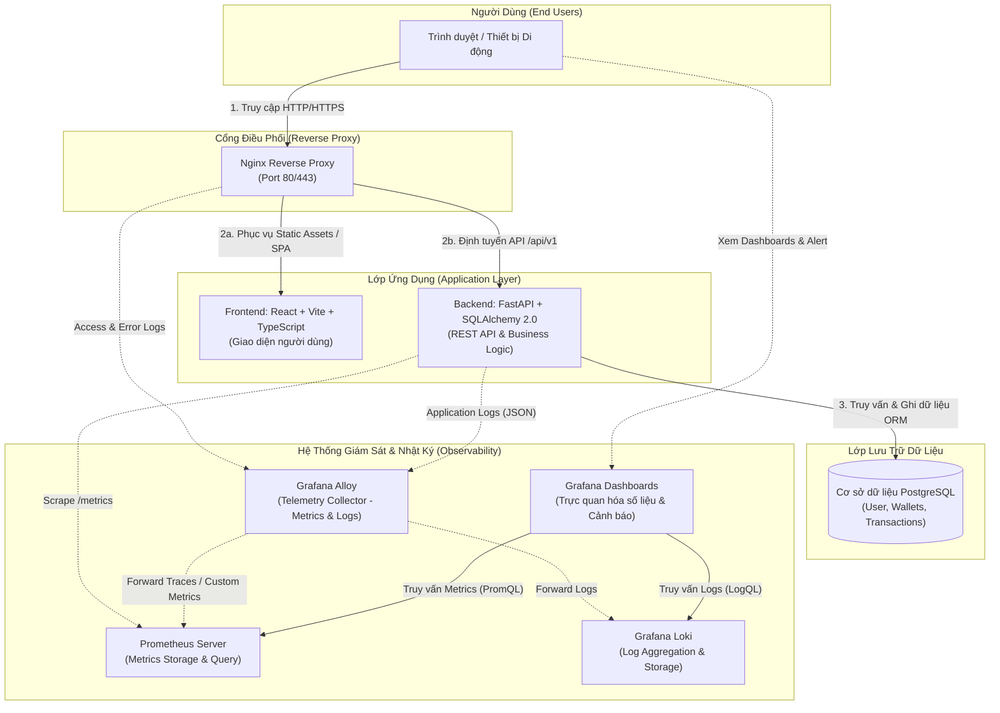

# Tài Liệu Kiến Trúc Tổng Quan Hệ Thống

Tài liệu này mô tả kiến trúc kỹ thuật dự kiến của hệ thống quản lý chi tiêu cá nhân và gia đình, bao gồm luồng dữ liệu ứng dụng và hệ thống giám sát / nhật ký tập trung.

---

## 1. Sơ Đồ Kiến Trúc Hệ Thống (Architecture Diagram)

---

## 2. Mô Tả Chi Tiết Các Thành Phần

### 2.1. Luồng Dữ Liệu Ứng Dụng (Application Flow)
1. **React (Frontend)**:
   * Ứng dụng Single Page Application (SPA) xây dựng bằng React và TypeScript.
   * Cung cấp giao diện trực quan cho việc ghi chép chi tiêu, quản lý các ví tiền, phân loại danh mục, và lập báo cáo tài chính gia đình.
2. **Nginx (Reverse Proxy & Gateway)**:
   * Tiếp nhận toàn bộ lưu lượng truy cập từ client trên cổng `80` / `443`.
   * Định tuyến các yêu cầu `/` và static assets tới ứng dụng React.
   * Chuyển tiếp các yêu cầu bắt đầu bằng `/api/` tới dịch vụ backend FastAPI.
3. **FastAPI (Backend)**:
   * Xử lý xác thực người dùng (JWT), kiểm tra quyền truy cập chi tiêu cá nhân và nhóm gia đình.
   * Xử lý logic nghiệp vụ, tính toán thống kê tài chính và xác thực dữ liệu đầu vào qua Pydantic schemas.
4. **PostgreSQL (Database)**:
   * Lưu trữ quan hệ bền vững cho người dùng, nhóm gia đình, tài khoản ví và các bản ghi giao dịch thu/chi.
   * Được quản trị schema migrations đồng bộ thông qua Alembic.

---

### 2.2. Hệ Thống Giám Sát & Nhật Ký (Observability Stack)
1. **Prometheus**:
   * Định kỳ thu thập số liệu vận hành (request rate, response time, status codes, tài nguyên) từ endpoint `/metrics` của FastAPI.
2. **Grafana Loki**:
   * Hệ thống lưu trữ và đánh chỉ mục nhật ký (logs) tập trung có hiệu năng cao, tối ưu dung lượng lưu trữ.
3. **Grafana Alloy**:
   * Đóng vai trò Telemetry Collector duy nhất, thu thập log từ container Nginx và ứng dụng FastAPI, chuẩn hóa và chuyển tiếp đến Loki và Prometheus.
4. **Grafana**:
   * Cung cấp giao diện dashboard duy nhất để theo dõi sức khỏe hệ thống, hiệu năng dịch vụ và gửi thông báo cảnh báo khi xảy ra sự cố.
